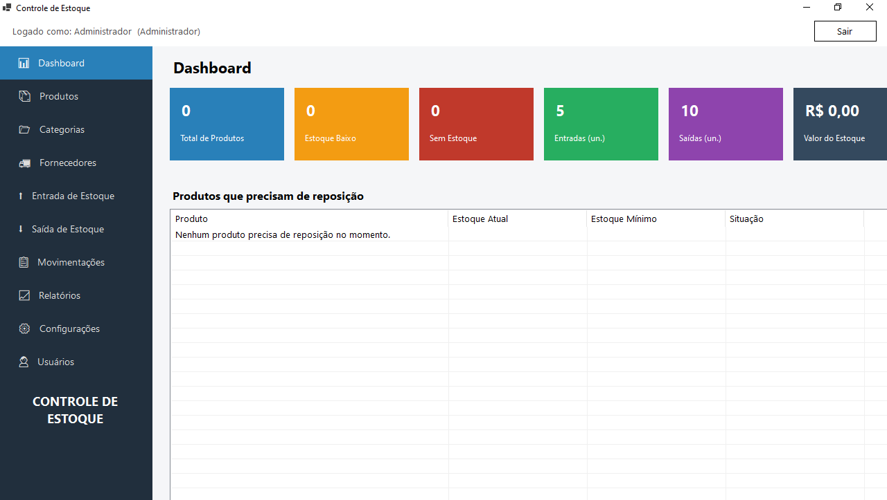

# 📦 Controle de Estoque Desktop

Aplicação desktop para gerenciamento e controle de estoque, desenvolvida em **C# com .NET e Windows Forms**.

O projeto tem como objetivo praticar o desenvolvimento de aplicações desktop, organização de código e separação de responsabilidades entre as diferentes camadas do sistema.

**Tecnologias principais:** C# · .NET · Windows Forms · Testes automatizados

## 🎯 Sobre o projeto

O Controle de Estoque Desktop é um projeto de portfólio desenvolvido para consolidar conhecimentos de programação e desenvolvimento de software.

A solução está organizada em projetos distintos, separando a interface desktop, as regras de domínio, a camada de aplicação, a infraestrutura e os testes.

## 🧱 Estrutura da solução

A solução está dividida nos seguintes projetos:

| Projeto | Responsabilidade |
|---|---|
| `ControleEstoque.Desktop` | Interface gráfica da aplicação |
| `ControleEstoque.Aplicacao` | Camada de aplicação e coordenação dos casos de uso |
| `ControleEstoque.Dominio` | Entidades e regras de domínio |
| `ControleEstoque.Infra` | Componentes de infraestrutura e acesso a recursos externos |
| `ControleEstoque.Testes` | Testes automatizados da solução |

*Nota: as responsabilidades devem ser ajustadas caso a implementação atual de cada projeto seja diferente.*

## 🛠️ Tecnologias utilizadas

- **C#** — linguagem de programação.
- **.NET** — plataforma de desenvolvimento.
- **Windows Forms** — criação da interface desktop.
- **Testes automatizados** — projeto dedicado à verificação do comportamento da aplicação.

## 🚀 Como executar o projeto

### Pré-requisitos

- Windows, para executar a aplicação Windows Forms.
- Visual Studio com suporte à versão do .NET utilizada pelo projeto.
- SDK do .NET compatível com a solução.

### 1. Clone o repositório

```bash
git clone https://github.com/JnatasSilva09/ControleEstoque.Desktop.git
```

### 2. Acesse a pasta

```bash
cd ControleEstoque.Desktop
```

### 3. Abra a solução

Abra o arquivo `ControleDeEstoque.slnx` no Visual Studio.

### 4. Restaure as dependências

Utilize a opção de restauração de pacotes NuGet do Visual Studio ou execute o comando abaixo, se compatível com o ambiente:

```bash
dotnet restore
```

### 5. Execute a aplicação

Defina `ControleEstoque.Desktop` como projeto de inicialização no Visual Studio e execute a solução.

> Os requisitos exatos de SDK e banco de dados dependem das configurações atuais do projeto.

## 🧪 Testes

A solução possui um projeto dedicado chamado `ControleEstoque.Testes`.

Para executar os testes pelo terminal, a partir da pasta da solução, utilize:

```bash
dotnet test
```

Confira o resultado da execução para verificar quais testes estão implementados e passando atualmente.

## 📸 Capturas de tela


```

Crie a pasta `docs/images` e coloque nela a imagem correspondente antes de utilizar esse exemplo.

## 🗺️ Próximas melhorias

As próximas etapas podem incluir, conforme as necessidades identificadas no projeto:

- Aprimorar a experiência visual e a navegação.
- Expandir a cobertura de testes.
- Melhorar o tratamento de erros e as mensagens apresentadas ao usuário.
- Documentar as principais funcionalidades e regras de negócio.
- Adicionar exemplos de uso e capturas de tela.

## 👨‍💻 Autor

**Jônatas Silva**

Estudante de Ciência da Computação, desenvolvendo projetos práticos para aprofundar conhecimentos em programação e engenharia de software.

- GitHub: [JnatasSilva09](https://github.com/JnatasSilva09)
- LinkedIn: [jonatas-coutinho-dev](https://www.linkedin.com/in/jonatas-coutinho-dev/)

---

Projeto de portfólio com foco em aprendizado, organização de código e evolução contínua.
